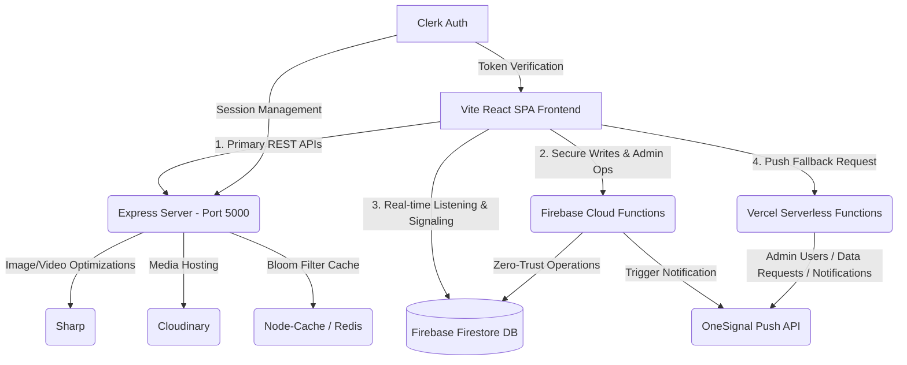
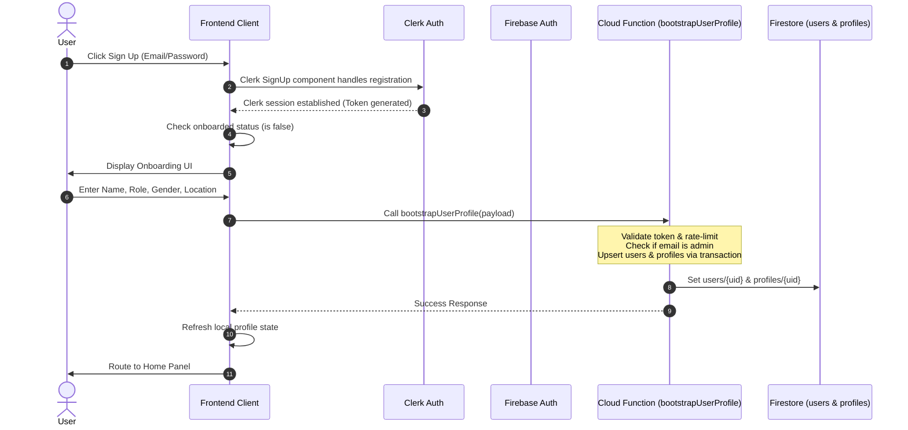
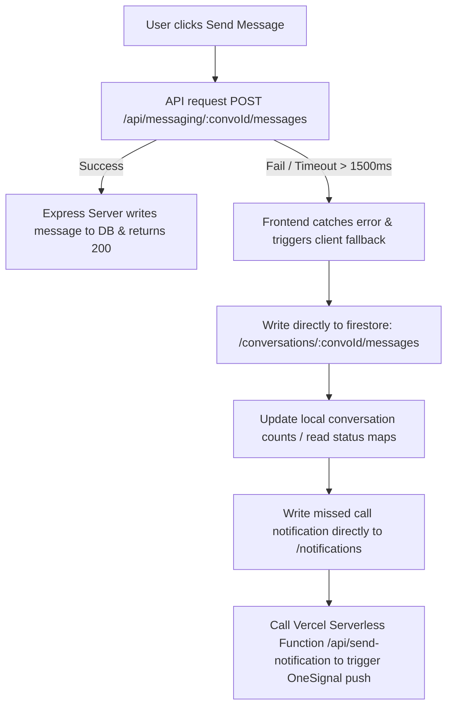
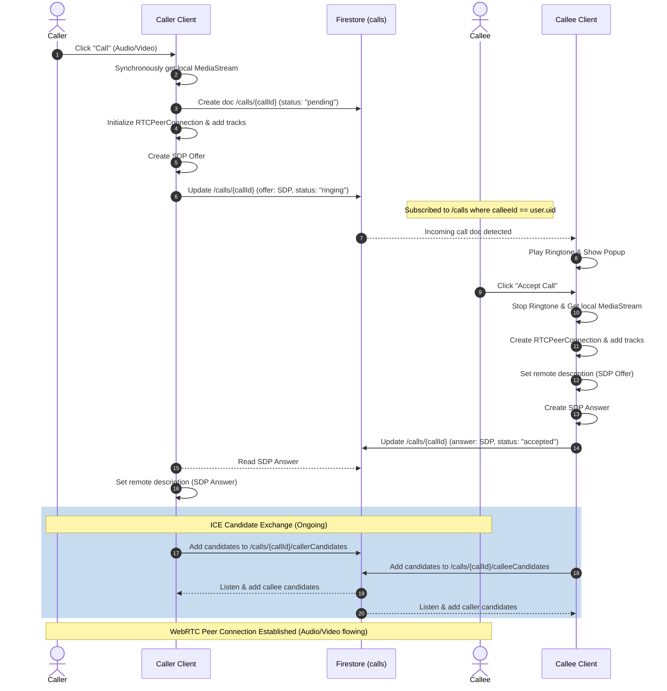

# NC-Network Project Brain & Workflows

This document is the single source of truth for NC-Network architecture, workflows, data models, and operational notes. It is intended for maintainers and contributors who need a concise reference for development, security posture, and deployments.

---

## 1. System Overview & High-Level Concept

NC-Network is a casting and professional talent platform that connects multiple industry roles:
*   **Talents**: Actors, Models, Dancers, Musicians, Voice Over Artists, VFX Artists, Writers.
*   **Creators/Recruiters**: Directors, Producers, Casting Directors, Agency Owners.

### Key Value Propositions
1.  **Professional Profiling**: Complete media-rich portfolios detailing physical attributes (height, weight, eye/hair color), skills, experience, languages, and work status (Open to Audition / Open to Work).
2.  **Zero-Latency WebRTC Communications**: Built-in real-time audio and video calling between talents and directors.
3.  **Auditions & Casting Portal**: Live board of casting calls where recruiters can publish opportunities and talents can directly apply.
4.  **Resilient Messaging Platform**: Instant chat featuring reactions, message pinning, replies, and notifications.
5.  **Hardened Security & Privacy**: Strict server-side validation, rate limiting, and zero-trust backend writes.
6.  **Internationalization (i18n)**: Multi-language support (English, Nepali, Hindi) with `react-i18next`.
7.  **Clerk Pro Authentication**: Enterprise-grade auth via Clerk with Firebase integration for database operations.

---

## 2. Technical Architecture

NC-Network uses a **hybrid, highly resilient backend architecture** built on top of React, Express, and Firebase.



### Stack Components
*   **Frontend**: 
    *   React 18 (Single Page Application via [vite.config.js](file:///c:/NepalCasts/NepalCasts/vite.config.js)).
    *   Styling: TailwindCSS 3, Framer Motion (for route transitions, call overlays, and splash screens), Radix UI primitive blocks, Shadcn-inspired components.
    *   Routing: React Router DOM 7 with code-split route modules in [src/routes/](file:///c:/NepalCasts/NepalCasts/src/routes).
    *   State Management: React Context Providers (`CallContext`, `PermissionContext`) in [src/context/](file:///c:/NepalCasts/NepalCasts/src/context), plus unified provider tree in [src/providers/AppProviders.tsx](file:///c:/NepalCasts/NepalCasts/src/providers/AppProviders.tsx).
    *   Authentication: [Clerk](https://clerk.com) via `@clerk/clerk-react` configured in [src/main.tsx](file:///c:/NepalCasts/NepalCasts/src/main.tsx).
    *   i18n: `react-i18next` with locale files in [src/i18n/](file:///c:/NepalCasts/NepalCasts/src/i18n) and [locales/](file:///c:/NepalCasts/NepalCasts/locales).
    *   SEO: `react-helmet-async` via [src/components/SEO.tsx](file:///c:/NepalCasts/NepalCasts/src/components/SEO.tsx).
*   **Database**: Firebase Firestore (NoSQL document store).
*   **Backend Functions (Secure writes)**: Firebase Cloud Functions V2 in [functions/src/index.ts](file:///c:/NepalCasts/NepalCasts/functions/src/index.ts), with modular handlers in [functions/src/handlers/](file:///c:/NepalCasts/NepalCasts/functions/src/handlers).
*   **Express Server**: Dedicated server in [server/src/index.ts](file:///c:/NepalCasts/NepalCasts/server/src/index.ts) that handles high-payload operations (Multer video/image file uploads, Sharp optimization to WebP, Cloudinary integration, Bloom filter caching, and structured middleware pipeline).
*   **Serverless Functions**: Vercel Serverless functions in [api/](file:///c:/NepalCasts/NepalCasts/api) handling admin user management, data request approvals/rejections, push notification fallbacks, and API proxying.
*   **Push Notifications**: OneSignal API.

---

## 3. Database Schema (Firestore)

The system relies on Firestore. Security constraints and schema policies are defined in [firestore.rules](file:///c:/NepalCasts/NepalCasts/firestore.rules).

### Core Collections

#### `profiles/{userId}`
Public profiles of all registered users.
*   **Fields**: `uid`, `name`, `role` (e.g. Actor, Model), `bio`, `location`, `gender`, `height`, `weight`, `eyeColor`, `hairColor`, `image`, `coverImage`, `media` (URLs), `verified` (boolean), `online` (boolean), `lastSeen` (timestamp), `deactivated` (boolean).
*   **Subcollection: `sessions/{sessionId}`**: Active authentication sessions detailing OS, Browser, Location, User Agent, and `lastActive` time. Used to revoke access if logins are suspicious.
*   **Subcollection: `login_history/{logId}`**: Record of log times and source metadata.

#### `users/{userId}`
Private user configuration database.
*   **Fields**: `uid`, `email`, `name`, `role`, `isAdmin` (boolean), `blockedUsers` (array of UIDs), `deletionScheduled` (boolean), `deletionGracePeriodEndsAt` (timestamp).
*   **Subcollection: `private/{document}`**: Encrypted or sensitive settings.
    *   **`settings`**: Document storing sensitive fields like `fcmTokens` (array of push tokens) to prevent public exposure.

#### `conversations/{convoId}`
Direct messaging channels.
*   **Fields**: `participants` (array of UIDs), `lastMessage` (string), `lastMessageAt` (timestamp), `unread` (boolean), `lastSenderId` (string), `readBy` (map of UID -> boolean), `unreadCounts` (map of UID -> number).
*   **Subcollection: `messages/{messageId}`**: Individual chat logs.
    *   **Fields**: `senderId` (UID or `"system"`), `text`, `type` (`"text" | "image" | "video" | "file"`), `isSystem` (boolean), `isPinned` (boolean), `reactions` (map of Emoji -> array of UIDs), `replyTo` (object), `createdAt` (timestamp).

#### `casting_calls/{callId}`
Casting calls published by creators.
*   **Fields**: `title`, `description`, `type` (`"Film" | "Commercial" | "Web Series" | "Theatre"`), `budget`, `location`, `highPriority` (boolean), `status` (`"Open" | "Closed"`), `createdBy` (UID), `createdAt`, `updatedAt`.

#### `applications/{appId}`
Talents' applications to specific casting calls.
*   **Fields**: `userId` (applicant UID), `creatorId` (casting director UID), `castingId` (casting call ID), `status`, `createdAt`.

#### `calls/{callId}`
WebRTC call signaling documents.
*   **Fields**: `callerId` (UID), `callerName`, `callerPhoto`, `calleeId` (UID), `calleeName`, `calleePhoto`, `callType` (`"audio" | "video"`), `status` (`"pending" | "ringing" | "accepted" | "rejected" | "ended" | "busy"`), `offer` (WebRTC offer SDP), `answer` (WebRTC answer SDP), `createdAt`.
*   **Subcollections: `callerCandidates/{candId}` & `calleeCandidates/{candId}`**: WebRTC ICE candidates exchanged during peer setup.

#### `notifications/{notifId}`
System alerts and push triggers.
*   **Fields**: `userId`, `senderId`, `senderName`, `senderAvatar`, `title`, `body`, `type` (`"message" | "follow" | "casting_match" | "review" | "call_missed"`), `isRead` (boolean), `targetUrl`, `createdAt`.

#### `reports/{reportId}`
User-generated flags for moderation review.
*   **Fields**: `reporterId`, `targetId`, `targetType` (`"user" | "casting" | "message"`), `reason` (`"spam" | "harassment" | "inappropriate" | "fake_profile" | "scam" | "other"`), `details`, `createdAt`.

---

## 4. Critical Workflows

### A. Authentication & Onboarding Workflow



### B. Chat Resiliency Workflow (API-to-Firestore Fallback)

The frontend uses a hybrid architecture to send messages. It first targets the fast Express server API. If the Express server is offline or times out, the client falls back to direct Firestore writes:



### C. WebRTC Audio/Video Call Signaling

WebRTC coordinates real-time calls using Firestore collections as an asynchronous signaling channel.



**Call Ending/Cleanup Actions:**
1.  **Hang Up**: Either peer calls `hangUp()`. This sets the Firestore call status to `"ended"`, releases the camera/microphone streams, and resets the peer connection.
2.  **No Answer / Decline**: If the callee declines (rejection) or fails to pick up, the status is updated to `"rejected"` or `"no-answer"`. The caller client captures this change and appends a transactional system message to the chat: `Audio call • Declined` or `Video call • Missed Call`.
3.  **Logs**: An entry is automatically logged to `/conversations/{convoId}/messages` as a system message describing the exact call duration (e.g., `Video call • 5m 12s`).

---

## 5. Security & Privacy Model

The application enforces strict defense-in-depth across the entire surface area.

### 1. Callable Zero-Trust Constraints
Cloud Functions use **Zod** schema validations on the payload. Every request must check:
*   **Authentication**: Caller must possess a verified Firebase Auth UID.
*   **Ownership Check**: A user cannot modify a profile that is not theirs (`auth.uid == targetUserId`).
*   **Participant Check**: A user cannot read, send, or edit messages inside a conversation unless their UID is declared inside the conversation's `participants` array.

### 2. Role-Based Access Control (RBAC)
Mutations related to administrative control (`adminCreateCastingCall`, `adminUpdateCastingCall`, `adminDeleteCastingCall`, `adminSetCastingPriority`) are restricted to administrators.
The administrator identity check requires:
1.  Firebase Auth token custom claim `admin === true`, OR
2.  The Firestore profile record value `users/{uid}.isAdmin == true`.
*Note: The email address `aniltimilsena53@gmail.com` is configured as the default global administrator account. Upon onboarding, this email is automatically bootstrap-granted the `isAdmin: true` flag in Firestore.*

### 3. Sliding Rate Limits
To prevent DoS attacks, functions are wrapped in an `enforceRateLimit` routine. It records events in the `securityRateLimits` collection:
*   **Bootstrap Profile**: Max 5 requests / 60 seconds.
*   **Profile Updates (`upsertProfile`)**: Max 30 requests / 60 seconds.
*   **Messages**: Max 60 requests / 60 seconds.
*   **Push Registration**: Max 20 requests / 300 seconds.

### 4. Express Server Middleware Stack
The Express server enforces its own layered security in [server/src/index.ts](file:///c:/NepalCasts/NepalCasts/server/src/index.ts):
*   **Helmet**: Security headers (CSP, X-Frame-Options, etc.).
*   **CORS**: Whitelist-only origin validation via [server/src/config/cors.ts](file:///c:/NepalCasts/NepalCasts/server/src/config/cors.ts).
*   **Rate Limiting**: Express `rate-limit` + custom [cacheProtection middleware](file:///c:/NepalCasts/NepalCasts/server/src/middleware/cacheProtection.ts).
*   **Auth Middleware**: Firebase token verification in [server/src/middleware/auth.ts](file:///c:/NepalCasts/NepalCasts/server/src/middleware/auth.ts).
*   **Upload Security**: Binary magic-number validation, MIME mismatch detection, and image metadata stripping via [server/src/middleware/uploadSecurity.ts](file:///c:/NepalCasts/NepalCasts/server/src/middleware/uploadSecurity.ts).
*   **Request ID**: Unique request tracking via [server/src/middleware/requestId.ts](file:///c:/NepalCasts/NepalCasts/server/src/middleware/requestId.ts).
*   **Zod Validation**: Schema validation middleware in [server/src/middleware/validation.ts](file:///c:/NepalCasts/NepalCasts/server/src/middleware/validation.ts).

### 5. Structured Audit Logs
Actions that are considered medium or high risk (such as deletion schedules, block lists, profile bootstrap, and admin alterations) write security payloads to the `securityEvents` collection. Administrators can read these audit logs through `/api/admin/log` (`admin_logs` collection).

---

## 6. Directory Structure

```
.
├── api/                                # Vercel Serverless Functions
│   ├── admin-users.js                  # Admin user management endpoints
│   ├── data-requests-approve.js        # Data request approval handler
│   ├── data-requests-reject.js         # Data request rejection handler
│   ├── debug.js                        # Debug utility endpoint
│   ├── proxy.js                        # API proxy relay
│   └── send-notification.js            # Fallback OneSignal push service
├── functions/                          # Firebase Cloud Functions (v2 HTTPS Callables)
│   ├── src/
│   │   ├── config.ts                   # Firebase Admin SDK initialization
│   │   ├── index.ts                    # Function exports entry point
│   │   ├── handlers/                   # Modular callable handlers
│   │   │   ├── admin.ts                # Admin RBAC operations
│   │   │   ├── casting.ts              # Casting call mutations
│   │   │   ├── messaging.ts            # Message CRUD operations
│   │   │   ├── notification.ts         # Push token registration
│   │   │   └── profile.ts             # Profile bootstrap & upsert
│   │   ├── lib/                        # Shared function utilities
│   │   │   ├── rateLimit.ts            # Per-user rolling rate limiter
│   │   │   └── validation.ts           # Zod schema validation helpers
│   │   └── schemas/                    # Zod payload schemas
│   │       └── index.ts                # All function input schemas
│   ├── package.json
│   └── tsconfig.json
├── server/                             # Express Backend Server (REST API)
│   ├── src/
│   │   ├── index.ts                    # Server entry: Express app, middleware pipeline, startup
│   │   ├── config/                     # Server configuration
│   │   │   ├── index.ts                # Firebase Admin init, app & PORT exports
│   │   │   ├── cloudinary.ts           # Cloudinary SDK configuration
│   │   │   └── cors.ts                 # CORS allowed origins
│   │   ├── middleware/                  # Express middleware pipeline
│   │   │   ├── auth.ts                 # Firebase token verification
│   │   │   ├── cacheProtection.ts      # Anti-cache-abuse rate limiting
│   │   │   ├── errorHandler.ts         # Global error handler
│   │   │   ├── errorLogger.ts          # Error logging utility
│   │   │   ├── rateLimiter.ts          # Per-route rate limiting (rate-limiter-flexible)
│   │   │   ├── requestId.ts            # Unique request ID injection
│   │   │   ├── uploadSecurity.ts       # Binary signature validation & image sanitization
│   │   │   └── validation.ts           # Zod request validation middleware
│   │   ├── routes/                     # REST API route handlers
│   │   │   ├── index.ts                # Global router aggregation
│   │   │   ├── admin.routes.ts         # Admin dashboard API endpoints
│   │   │   ├── casting.routes.ts       # Casting call CRUD endpoints
│   │   │   ├── messaging.routes.ts     # Messaging API endpoints
│   │   │   ├── notification.routes.ts  # Notification management endpoints
│   │   │   ├── profile.routes.ts       # Profile API endpoints
│   │   │   └── upload.routes.ts        # Media upload endpoints (Multer + Sharp + Cloudinary)
│   │   ├── services/                   # Business logic services
│   │   │   ├── cacheService.ts         # Bloom filter initialization & cache management
│   │   │   ├── listeners.service.ts    # Background Firestore listeners for push notifications
│   │   │   ├── media.service.ts        # Media processing (Sharp, Cloudinary)
│   │   │   ├── messaging.service.ts    # Message CRUD service layer
│   │   │   ├── notification.service.ts # Notification dispatch service
│   │   │   └── profile.service.ts      # Profile data service layer
│   │   ├── schemas/                    # Zod validation schemas
│   │   │   └── index.ts                # All server input schemas
│   │   ├── types/                      # TypeScript type definitions
│   │   │   └── index.ts                # Server-side type exports
│   │   └── tests/                      # Server test suite
│   │       ├── firestoreRules.test.ts  # Firestore security rules tests
│   │       └── upload.test.ts          # Upload endpoint tests
│   ├── package.json
│   └── tsconfig.json
├── src/                                # Frontend Web Application
│   ├── api/                            # API client layer
│   │   ├── client.ts                   # Axios instance config (for Express REST)
│   │   └── functionsClient.ts          # HTTPS Callable helper (for Cloud Functions)
│   ├── components/                     # React UI Components
│   │   ├── admin/                      # Admin-specific components
│   │   │   └── AdminSidebar.tsx        # Admin panel navigation sidebar
│   │   ├── curator/                    # Curator components (reserved)
│   │   ├── icons/                      # Custom icon components
│   │   │   └── CategoryIcons.jsx       # Category-specific SVG icons
│   │   ├── layout/                     # Layout structural components
│   │   │   ├── Desktop3ColumnLayout.jsx # Responsive 3-column desktop layout
│   │   │   ├── Footer.jsx             # Site footer
│   │   │   └── Navbar.jsx             # Global navigation bar
│   │   ├── profile/                    # Profile-related shared components
│   │   │   ├── RatingOverview.jsx      # Rating summary display
│   │   │   └── ReviewSection.jsx       # User review listing
│   │   ├── ui/                         # Reusable design system components
│   │   │   ├── ActionSearchBar.tsx     # Global search bar with actions
│   │   │   ├── AdBanner.tsx            # Advertisement banner
│   │   │   ├── AlertBanner.tsx         # System alert banners
│   │   │   ├── AnimatedStateIcons.tsx  # Animated status indicator icons
│   │   │   ├── Avatar.tsx             # User avatar component
│   │   │   ├── Button.jsx            # Base button component
│   │   │   ├── CategoryIcon.tsx       # Category icon wrapper
│   │   │   ├── CategorySkeleton.jsx   # Category loading skeleton
│   │   │   ├── ConfirmDialog.tsx      # Confirmation modal dialog
│   │   │   ├── CropModal.jsx         # Image cropping modal
│   │   │   ├── FileUploadCard.tsx     # File upload dropzone card
│   │   │   ├── GlassCard.jsx         # Glassmorphism card wrapper
│   │   │   ├── Logo.jsx              # NC-Network logo component
│   │   │   ├── PermissionModal.jsx    # Permission request modal
│   │   │   ├── PricingCards.tsx       # Premium pricing tier cards
│   │   │   ├── PullToRefresh.tsx      # Mobile pull-to-refresh
│   │   │   ├── ShadcnButton.tsx       # Shadcn-style button variant
│   │   │   ├── ShadcnCard.tsx         # Shadcn-style card variant
│   │   │   ├── ShadcnSeparator.tsx    # Shadcn-style separator
│   │   │   ├── ShadcnSwitch.tsx       # Shadcn-style toggle switch
│   │   │   ├── ShareSheet.tsx         # Social share bottom sheet
│   │   │   ├── Skeleton.tsx           # Loading skeleton primitives
│   │   │   ├── Tag.jsx               # Tag/badge component
│   │   │   ├── TalentCardSkeleton.jsx # Talent card loading skeleton
│   │   │   ├── ToastNotification.tsx  # Toast notification system
│   │   │   ├── progress.tsx           # Progress bar component
│   │   │   └── index.ts              # UI components barrel export
│   │   ├── ErrorBoundary.tsx           # Global React error boundary
│   │   ├── Onboarding.tsx              # Initial registration questionnaire
│   │   ├── RouteLoader.tsx             # Route-level loading indicator
│   │   ├── SplashScreen.tsx            # App splash screen
│   │   └── SEO.tsx                     # SEO Meta tags and Head injection
│   ├── config/                         # Frontend configuration
│   │   ├── categories.ts              # Talent category definitions
│   │   └── i18n.ts                    # i18n initialization config
│   ├── constants/                      # Application constants
│   │   ├── categories.ts              # Category constant values
│   │   ├── collections.ts            # Firestore collection name constants
│   │   └── index.ts                   # Constants barrel export
│   ├── context/                        # React Context providers
│   │   ├── CallContext.tsx             # Primary WebRTC execution context
│   │   ├── PermissionContext.jsx       # Mic/Camera permissions provider
│   │   └── index.ts                   # Context barrel export
│   ├── features/                       # Self-contained business module features
│   │   ├── admin/                      # Admin dashboard & management
│   │   │   ├── AdminAnalytics.tsx     # Analytics dashboard page
│   │   │   ├── AdminCasting.tsx       # Casting management page
│   │   │   ├── AdminContent.tsx       # Content management page
│   │   │   ├── AdminMessages.tsx      # Message moderation page
│   │   │   ├── AdminModeration.tsx    # User moderation page
│   │   │   ├── AdminOverview.tsx      # Dashboard overview page
│   │   │   ├── AdminPro.tsx           # Pro/Premium management page
│   │   │   ├── AdminSettings.tsx      # Admin settings page
│   │   │   ├── AdminUsers.tsx         # User management page
│   │   │   └── services/             # Admin API service layer
│   │   │       └── admin.ts
│   │   ├── auth/                       # Authentication pages
│   │   │   ├── ForgotPassword.tsx     # Password reset request
│   │   │   ├── ResetPassword.tsx      # Password reset form
│   │   │   ├── SignIn.tsx             # Sign in page
│   │   │   ├── SignUp.tsx             # Sign up page
│   │   │   ├── VerifyEmail.tsx        # Email verification page
│   │   │   └── services/             # Auth service layer
│   │   ├── call/                       # WebRTC calling feature
│   │   │   ├── CallPage.tsx           # Active call UI
│   │   │   ├── components/            # Call UI components
│   │   │   ├── services/             # Call signaling services
│   │   │   └── types/                # Call type definitions
│   │   ├── casting/                    # Casting portal feature
│   │   │   ├── ApplicationsPage.tsx   # User's applications list
│   │   │   ├── CastingCall.jsx        # Casting calls listing page
│   │   │   ├── CastingCallCreate.tsx  # Create/edit casting call form
│   │   │   ├── CastingCallDetail.tsx  # Single casting call detail
│   │   │   ├── SavedCastingCalls.jsx  # Saved/bookmarked casting calls
│   │   │   ├── services/             # Casting API services
│   │   │   └── types/                # Casting type definitions
│   │   ├── messages/                   # Messaging feature
│   │   │   ├── MessagesPage.tsx       # DM / Chat page
│   │   │   ├── components/            # Chat UI components
│   │   │   ├── hooks/                # Messaging custom hooks
│   │   │   ├── services/             # Messaging API services
│   │   │   └── types/                # Messaging type definitions
│   │   ├── notifications/             # Notifications feature
│   │   │   ├── Notifications.jsx      # Notifications page
│   │   │   └── types/                # Notification type definitions
│   │   ├── profile/                    # User profile feature
│   │   │   ├── ProfileCreate.jsx      # Profile creation/editing
│   │   │   ├── ProfilePage.tsx        # Profile view page
│   │   │   ├── index.ts              # Profile barrel export
│   │   │   ├── components/            # Profile UI components
│   │   │   ├── hooks/                # Profile custom hooks
│   │   │   ├── services/             # Profile API services
│   │   │   └── types/                # Profile type definitions
│   │   └── settings/                   # Settings feature
│   │       ├── SettingsPage.tsx        # Settings page
│   │       ├── index.ts              # Settings barrel export
│   │       ├── components/            # Settings UI components
│   │       └── hooks/                # Settings custom hooks
│   ├── hooks/                          # Global custom hooks
│   │   ├── useWebRTC.ts               # RTCPeerConnection WebRTC logic handler
│   │   ├── usePermissions.js          # Browser permission management hook
│   │   └── index.ts                   # Hooks barrel export
│   ├── i18n/                           # Internationalization
│   │   ├── LanguageProvider.tsx        # Language context provider
│   │   ├── formatters.ts             # i18n formatting utilities
│   │   ├── index.ts                   # i18n setup & initialization
│   │   ├── en.json                    # English translations
│   │   └── ne.json                    # Nepali translations
│   ├── layouts/                        # Page layout wrappers
│   │   ├── AdminLayout.tsx            # Admin dashboard layout (sidebar + content)
│   │   ├── PublicLayout.tsx           # Public/unauthenticated layout
│   │   └── UserLayout.tsx             # Authenticated user layout (navbar + footer)
│   ├── lib/                            # Core library utilities
│   │   ├── firebase.ts                # Firebase app initialization & SDK exports
│   │   └── utils.ts                   # General utility functions (cn helper)
│   ├── pages/                          # Global/Static page components
│   │   ├── About.jsx                  # About page
│   │   ├── Contact.jsx                # Contact page
│   │   ├── Forbidden.tsx              # 403 Forbidden page
│   │   ├── Help.jsx                   # Help/FAQ page
│   │   ├── Home.jsx                   # Landing & User dashboard
│   │   ├── NotFound.tsx               # 404 page
│   │   ├── Premium.tsx                # Premium subscription page
│   │   ├── PrivacyPolicy.jsx          # Privacy policy page
│   │   ├── ServerError.tsx            # 500 Server error page
│   │   ├── TalentListing.jsx          # Talent search/listing board
│   │   ├── TermsOfService.jsx         # Terms of service page
│   │   ├── Trending.jsx               # Trending talents page
│   │   └── TrustSafety.jsx           # Trust & safety page
│   ├── providers/                      # App-level provider wrappers
│   │   ├── AppProviders.tsx           # Unified provider tree (Auth, User, Call, Toast, etc.)
│   │   └── DialogProvider.tsx         # Global dialog/confirm modal provider
│   ├── routes/                         # Code-split route definitions
│   │   ├── routeConfig.tsx            # Master route configuration
│   │   ├── index.tsx                  # Routes barrel export
│   │   ├── admin.routes.tsx           # Admin panel routes
│   │   ├── applications.routes.tsx    # Applications routes
│   │   ├── calls.routes.tsx           # Call routes
│   │   ├── casting.routes.tsx         # Casting routes
│   │   ├── discover.routes.tsx        # Discovery/explore routes
│   │   ├── messages.routes.tsx        # Messaging routes
│   │   ├── notifications.routes.tsx   # Notification routes
│   │   ├── profile.routes.tsx         # Profile routes
│   │   ├── saved.routes.tsx           # Saved items routes
│   │   └── settings.routes.tsx        # Settings routes
│   ├── services/                       # Frontend service layer
│   │   ├── AuthService.ts            # Authentication service
│   │   ├── MediaOptimizer.ts          # Client-side media optimization
│   │   ├── storage.ts                 # Global storage uploads
│   │   └── index.ts                   # Services barrel index
│   ├── tests/                          # Frontend test suite
│   │   ├── auth.test.tsx              # Authentication tests
│   │   └── setup.ts                   # Test setup & configuration
│   ├── types/                          # Global TypeScript type definitions
│   │   ├── api.ts                     # API contract models
│   │   └── index.ts                   # Types barrel index
│   ├── utils/                          # Utility functions & helpers
│   │   ├── CurrentUser.ts             # Current user state helper
│   │   ├── avatars.ts                 # Avatar generation/fallback
│   │   ├── cacheManager.ts            # Client-side cache management
│   │   ├── draftStorage.ts            # Message draft persistence
│   │   ├── errorHandler.ts            # Global error handling
│   │   ├── errorTracking.ts           # Error tracking & reporting
│   │   ├── format.ts                  # Display formatting utilities
│   │   ├── lazyWithRetry.ts           # Lazy loading with retry logic
│   │   ├── logger.ts                  # Console logging utility
│   │   ├── media.ts                   # Media helper utilities
│   │   ├── notification-sound.ts      # Notification sound player
│   │   ├── oneSignal.ts               # OneSignal SDK integration
│   │   ├── rateLimitedFirestore.ts    # Rate-limited Firestore writes
│   │   ├── ringtone.ts               # Call ringtone manager
│   │   ├── security.ts               # Client-side security utilities
│   │   ├── uploadMedia.ts            # Media upload orchestration
│   │   └── index.ts                   # Utils barrel export
│   ├── App.tsx                         # Main App component (providers + route config)
│   ├── main.tsx                        # React Entrypoint (Clerk, BrowserRouter, ErrorBoundary)
│   ├── global.d.ts                     # Global TypeScript declarations
│   └── index.css                       # Global styles (TailwindCSS directives + custom CSS)
├── locales/                            # i18n translation files (root-level)
│   ├── en.json                        # English translations
│   ├── ne.json                        # Nepali translations
│   ├── np.json                        # Nepali (alt) translations
│   └── hi.json                        # Hindi translations
├── scripts/                            # Admin & migration scripts
│   ├── cleanPasswords.cjs             # Password cleanup utility
│   ├── deleteStories.cjs             # Story deletion utility
│   ├── listProfiles.cjs              # Profile listing utility
│   ├── listUsers.cjs                 # User listing utility
│   ├── makeAdmin.cjs                 # Admin privilege assignment
│   ├── migrateCategories.js          # Category migration script
│   ├── migrateToSingularCategories.js # Category normalization script
│   └── syncAllAdminClaims.cjs        # Admin claims synchronization
├── docs/                               # Project documentation
│   └── SEO_SSR_RECOMMENDATIONS.md     # SEO & SSR strategy recommendations
├── public/                             # Static public assets
│   ├── OneSignalSDKWorker.js          # OneSignal service worker
│   ├── firebase-messaging-sw.js       # Firebase Cloud Messaging service worker
│   ├── assets/                        # Static asset files
│   ├── logo.png                       # NC-Network logo
│   ├── hero-bg.webp                   # Hero background image (optimized)
│   ├── cinematic_backstage.png        # Cinematic background asset
│   └── notification.mp3              # Notification sound effect
├── firestore.rules                     # Firestore security rules
├── firestore.indexes.json              # Firestore composite index definitions
├── storage.rules                       # Firebase Storage security rules
├── firebase.json                       # Firebase deployment config (functions, rules, emulators)
├── vercel.json                         # Vercel SPA rewrites & security headers
├── vite.config.js                      # Vite build configuration
├── tailwind.config.js                  # TailwindCSS configuration
├── postcss.config.js                   # PostCSS configuration
├── tsconfig.json                       # TypeScript configuration (frontend)
├── eslint.config.js                    # ESLint configuration
└── package.json                        # Dependencies listing
```

---

## 7. Key Operational Details & Maintenance

### 1. Deployment Actions
*   **Vite Frontend (Vercel)**: Deployed to Vercel. SPA paths are preserved via redirection rewrite config inside [vercel.json](file:///c:/NepalCasts/NepalCasts/vercel.json).
*   **Firebase Functions**: Deployed using `firebase deploy --only functions`.
*   **Firestore Rules**: Deployed using `firebase deploy --only firestore:rules`.
*   **Storage Rules**: Deployed using `firebase deploy --only storage`.

### 2. Development Setup
*   **Start both frontend & server**: `npm run dev:all` (uses `concurrently` to run Vite on port 3000 and Express on port 5000).
*   **Start frontend only**: `npm run dev` (Vite dev server on port 3000).
*   **Start server only**: `npm run dev:server` (Express API on port 5000).
*   **Run tests**: `npm test` (frontend Vitest), `cd server && npm test` (server Vitest).
*   **Required environment variables**: See [.env.example](file:///c:/NepalCasts/NepalCasts/.env.example) and [server/.env.example](file:///c:/NepalCasts/NepalCasts/server/.env.example). Key variables include:
    *   `VITE_CLERK_PUBLISHABLE_KEY` — Clerk authentication (app won't render without a valid key).
    *   `VITE_FIREBASE_*` — Firebase client SDK config.
    *   `FIREBASE_PRIVATE_KEY` / `FIREBASE_CLIENT_EMAIL` — Server-side Firebase Admin credentials.

### 3. Dynamic Update Checking
[App.tsx](file:///c:/NepalCasts/NepalCasts/src/App.tsx) delegates routing to [routeConfig.tsx](file:///c:/NepalCasts/NepalCasts/src/routes/routeConfig.tsx). The unified provider tree in [AppProviders.tsx](file:///c:/NepalCasts/NepalCasts/src/providers/AppProviders.tsx) manages user state, auth, calling, toast notifications, and alert banners.

### 4. Grace-period Deletion Flow
When users delete their profile, the account is marked with a 30-day grace period timestamp. If they sign in during this period, the app interrupts the session with a block screen, offering to cancel the deletion schedule and restore the account or sign out.

### 5. Known Development Notes
*   The `file-type` package (v19+) is ESM-only. The server uses a dynamic `import()` workaround in [uploadSecurity.ts](file:///c:/NepalCasts/NepalCasts/server/src/middleware/uploadSecurity.ts) since the server is CommonJS (`"type": "commonjs"`).
*   The server requires Firebase ADC (Application Default Credentials) or a valid `FIREBASE_PRIVATE_KEY` to connect to Firestore. Without credentials, Firestore listeners will crash the server process after initialization.
*   Firebase emulators are configured in [firebase.json](file:///c:/NepalCasts/NepalCasts/firebase.json) (Firestore on port 8080 with UI enabled).
