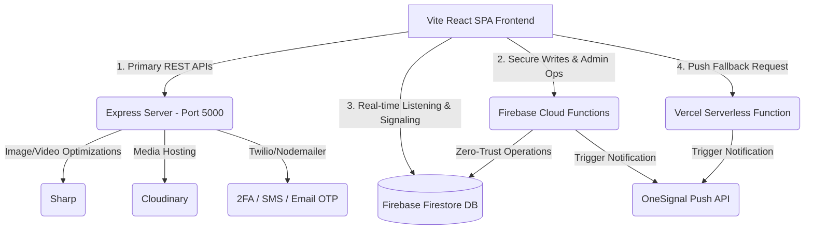
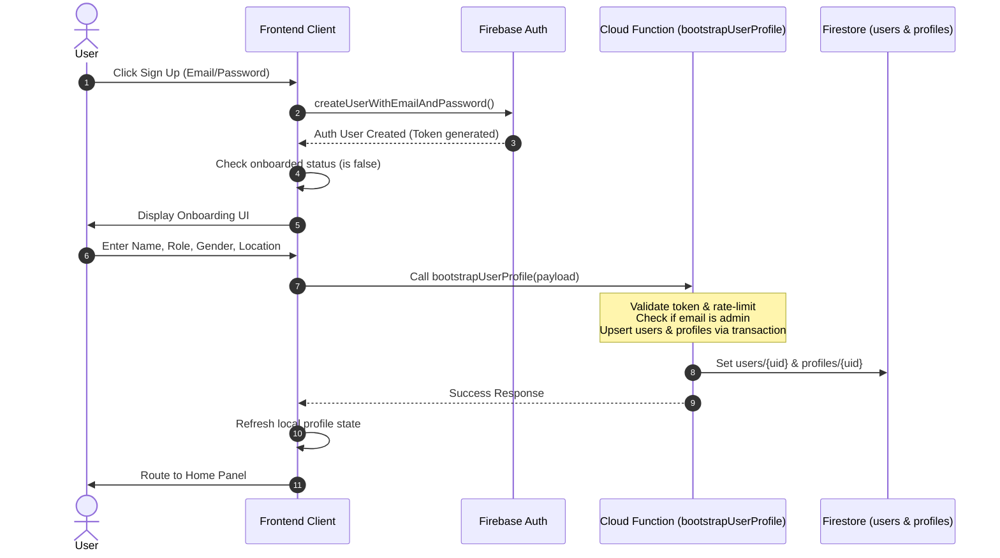
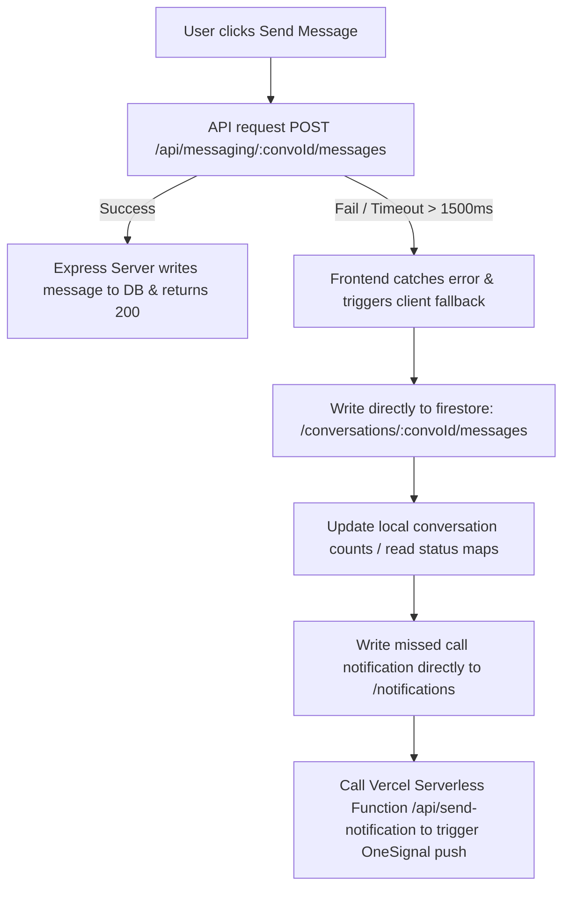
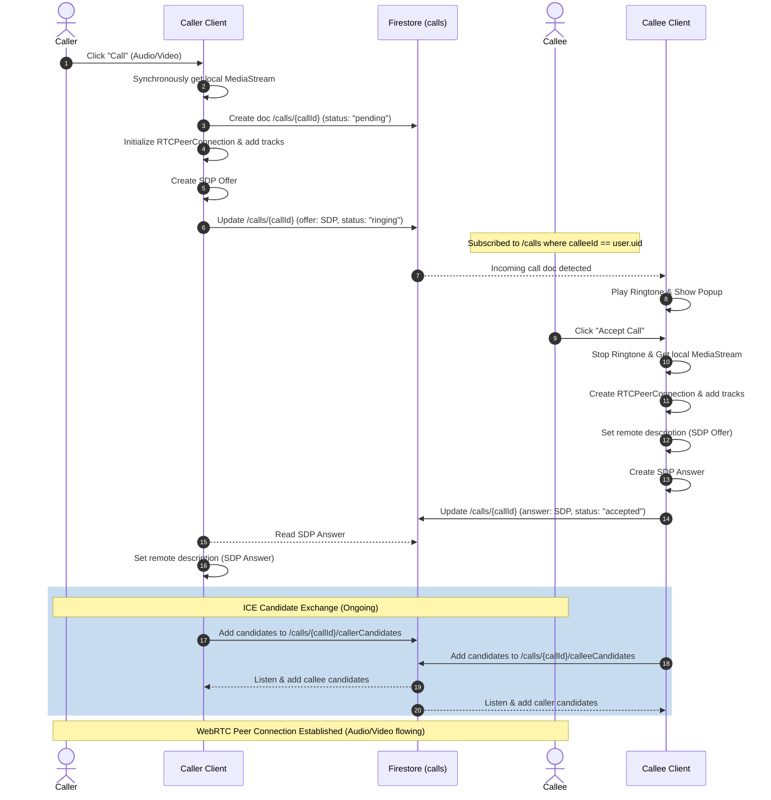

# NC-Network Project Brain & Workflows

Welcome to the **NC-Network** project documentation brain. This file contains the complete architectural blueprints, workflows, database models, and security postures of the application. Use this document as the single source of truth for repository structure and runtime execution logic.

---

## 1. System Overview & High-Level Concept

**NC-Network** is Nepal's premier casting and professional talent network. It acts as a professional matchmaking, communication, and auditioning portal for the Nepalese entertainment industry, connecting multiple professional roles:
*   **Talents**: Actors, Models, Dancers, Musicians, Voice Over Artists, VFX Artists, Writers.
*   **Creators/Recruiters**: Directors, Producers, Casting Directors, Agency Owners.

### Key Value Propositions
1.  **Professional Profiling**: Complete media-rich portfolios detailing physical attributes (height, weight, eye/hair color), skills, experience, languages, and work status (Open to Audition / Open to Work).
2.  **Zero-Latency WebRTC Communications**: Built-in real-time audio and video calling between talents and directors.
3.  **Auditions & Casting Portal**: Live board of casting calls where recruiters can publish opportunities and talents can directly apply.
4.  **Resilient Messaging Platform**: Instant chat featuring reactions, message pinning, replies, and notifications.
5.  **Hardened Security & Privacy**: Strict server-side validation, rate limiting, and zero-trust backend writes.

---

## 2. Technical Architecture

NC-Network uses a **hybrid, highly resilient backend architecture** built on top of React, Express, and Firebase.



### Stack Components
*   **Frontend**: 
    *   React 18 (Single Page Application via [vite.Config.js](file:///c:/Users/iamdi/Downloads/NC-Network-copilot-nc-network-design-system/NC-Network-copilot-nc-network-design-system/vite.config.js)).
    *   Styling: TailwindCSS 3, Framer Motion (for route transitions, call overlays, and splash screens), Radix UI primitive UI blocks.
    *   Routing: React Router DOM 7.
    *   State Management: React Context Providers (`CallContext`, `UserContext`, `PermissionContext`).
*   **Database**: Firebase Firestore (NoSQL document store).
*   **Backend Functions (Secure writes)**: Firebase Cloud Functions V2 in [functions/src/index.ts](file:///c:/Users/iamdi/Downloads/NC-Network-copilot-nc-network-design-system/NC-Network-copilot-nc-network-design-system/functions/src/index.ts).
*   **Express Server**: Dedicated server in [server/src/index.ts](file:///c:/Users/iamdi/Downloads/NC-Network-copilot-nc-network-design-system/NC-Network-copilot-nc-network-design-system/server/src/index.ts) that handles high-payload operations (such as Multer video/image file uploads, Sharp optimization to WebP, Cloudinary integration, Nodemailer email verification, and Twilio SMS).
*   **Serverless Function**: Vercel Serverless function in [api/send-notification.js](file:///c:/Users/iamdi/Downloads/NC-Network-copilot-nc-network-design-system/NC-Network-copilot-nc-network-design-system/api/send-notification.js) that triggers OneSignal push notifications if the Express server falls back.
*   **Push Notifications**: OneSignal API.

---

## 3. Database Schema (Firestore)

The system relies on Firestore. Security constraints and schema policies are defined in [firestore.rules](file:///c:/Users/iamdi/Downloads/NC-Network-copilot-nc-network-design-system/NC-Network-copilot-nc-network-design-system/firestore.rules).

### Core Collections

#### `profiles/{userId}`
Public profiles of all registered users.
*   **Fields**: `uid`, `name`, `role` (e.g. Actor, Model), `bio`, `location`, `gender`, `height`, `weight`, `eyeColor`, `hairColor`, `image`, `coverImage`, `media` (URLs), `verified` (boolean), `online` (boolean), `lastSeen` (timestamp), `deactivated` (boolean).
*   **Subcollection: `sessions/{sessionId}`**: Active authentication sessions detailing OS, Browser, Location, User Agent, and `lastActive` time. Used to revoke access if logins are suspicious.
*   **Subcollection: `login_history/{logId}`**: Record of log times and source metadata.

#### `users/{userId}`
Private user configuration database.
*   **Fields**: `uid`, `email`, `name`, `role`, `isAdmin` (boolean), `blockedUsers` (array of UIDs), `deletionScheduled` (boolean), `deletionGracePeriodEndsAt` (timestamp).
*   **Subcollection: `private/{document}`**: Encrypted or sensitive settings.
    *   **`settings`**: Document storing sensitive fields like `fcmTokens` (array of push tokens) to prevent public exposure.

#### `conversations/{convoId}`
Direct messaging channels.
*   **Fields**: `participants` (array of UIDs), `lastMessage` (string), `lastMessageAt` (timestamp), `unread` (boolean), `lastSenderId` (string), `readBy` (map of UID -> boolean), `unreadCounts` (map of UID -> number).
*   **Subcollection: `messages/{messageId}`**: Individual chat logs.
    *   **Fields**: `senderId` (UID or `"system"`), `text`, `type` (`"text" | "image" | "video" | "file"`), `isSystem` (boolean), `isPinned` (boolean), `reactions` (map of Emoji -> array of UIDs), `replyTo` (object), `createdAt` (timestamp).

#### `casting_calls/{callId}`
Casting calls published by creators.
*   **Fields**: `title`, `description`, `type` (`"Film" | "Commercial" | "Web Series" | "Theatre"`), `budget`, `location`, `highPriority` (boolean), `status` (`"Open" | "Closed"`), `createdBy` (UID), `createdAt`, `updatedAt`.

#### `applications/{appId}`
Talents' applications to specific casting calls.
*   **Fields**: `userId` (applicant UID), `creatorId` (casting director UID), `castingId` (casting call ID), `status`, `createdAt`.

#### `calls/{callId}`
WebRTC call signaling documents.
*   **Fields**: `callerId` (UID), `callerName`, `callerPhoto`, `calleeId` (UID), `calleeName`, `calleePhoto`, `callType` (`"audio" | "video"`), `status` (`"pending" | "ringing" | "accepted" | "rejected" | "ended" | "busy"`), `offer` (WebRTC offer SDP), `answer` (WebRTC answer SDP), `createdAt`.
*   **Subcollections: `callerCandidates/{candId}` & `calleeCandidates/{candId}`**: WebRTC ICE candidates exchanged during peer setup.

#### `notifications/{notifId}`
System alerts and push triggers.
*   **Fields**: `userId`, `senderId`, `senderName`, `senderAvatar`, `title`, `body`, `type` (`"message" | "follow" | "casting_match" | "review" | "call_missed"`), `isRead` (boolean), `targetUrl`, `createdAt`.

#### `reports/{reportId}`
User-generated flags for moderation review.
*   **Fields**: `reporterId`, `targetId`, `targetType` (`"user" | "casting" | "message"`), `reason` (`"spam" | "harassment" | "inappropriate" | "fake_profile" | "scam" | "other"`), `details`, `createdAt`.

---

## 4. Critical Workflows

### A. Authentication & Onboarding Workflow



### B. Chat Resiliency Workflow (API-to-Firestore Fallback)

The frontend uses a hybrid architecture to send messages. It first targets the fast Express server API. If the Express server is offline or times out, the client falls back to direct Firestore writes:



### C. WebRTC Audio/Video Call Signaling

WebRTC coordinates real-time calls using Firestore collections as an asynchronous signaling channel.



**Call Ending/Cleanup Actions:**
1.  **Hang Up**: Either peer calls `hangUp()`. This sets the Firestore call status to `"ended"`, releases the camera/microphone streams, and resets the peer connection.
2.  **No Answer / Decline**: If the callee declines (rejection) or fails to pick up, the status is updated to `"rejected"` or `"no-answer"`. The caller client captures this change and appends a transactional system message to the chat: `Audio call • Declined` or `Video call • Missed Call`.
3.  **Logs**: An entry is automatically logged to `/conversations/{convoId}/messages` as a system message describing the exact call duration (e.g., `Video call • 5m 12s`).

---

## 5. Security & Privacy Model

The application enforces strict defense-in-depth across the entire surface area.

### 1. Callable Zero-Trust Constraints
Cloud Functions use **Zod** schema validations on the payload. Every request must check:
*   **Authentication**: Caller must possess a verified Firebase Auth UID.
*   **Ownership Check**: A user cannot modify a profile that is not theirs (`auth.uid == targetUserId`).
*   **Participant Check**: A user cannot read, send, or edit messages inside a conversation unless their UID is declared inside the conversation's `participants` array.

### 2. Role-Based Access Control (RBAC)
Mutations related to administrative control (`adminCreateCastingCall`, `adminUpdateCastingCall`, `adminDeleteCastingCall`, `adminSetCastingPriority`) are restricted to administrators.
The administrator identity check requires:
1.  Firebase Auth token custom claim `admin === true`, OR
2.  The Firestore profile record value `users/{uid}.isAdmin == true`.
*Note: The email address `aniltimilsena53@gmail.com` is configured as the default global administrator account. Upon onboarding, this email is automatically bootstrap-granted the `isAdmin: true` flag in Firestore.*

### 3. sliding Rate Limits
To prevent DoS attacks, functions are wrapped in an `enforceRateLimit` routine. It records events in the `securityRateLimits` collection:
*   **Bootstrap Profile**: Max 5 requests / 60 seconds.
*   **Profile Updates (`upsertProfile`)**: Max 30 requests / 60 seconds.
*   **Messages**: Max 60 requests / 60 seconds.
*   **Push Registration**: Max 20 requests / 300 seconds.

### 4. Structured Audit Logs
Actions that are considered medium or high risk (such as deletion schedules, block lists, profile bootstrap, and admin alterations) write security payloads to the `securityEvents` collection. Administrators can read these audit logs through `/api/admin/log` (`admin_logs` collection).

---

## 6. Directory Structure

```
.
├── api/                            # Vercel Serverless Functions
│   └── send-notification.js        # Fallback OneSignal push service
├── functions/                      # Firebase Cloud Functions (v2 HTTPS Callables)
│   ├── src/
│   │   └── index.ts                # Zero-trust write actions, rate limits, push triggers
│   ├── package.json
│   └── tsconfig.json
├── server/                         # Express Backend Server (REST API)
│   ├── src/
│   │   ├── index.ts                # Multer upload, Cloudinary upload, Twilio/SMS OTP
│   │   └── migrateCategories.ts    # DB setup & data seeding scripts
│   ├── package.json
│   └── tsconfig.json
├── src/                            # Frontend Web Application
│   ├── api/
│   │   ├── client.ts               # Axios instance config (for Express REST)
│   │   └── functionsClient.ts      # HTTPS Callable helper (for Cloud Functions)
│   ├── components/                 # React UI Components
│   │   ├── calling/                # WebRTC overlay and incoming ring popup
│   │   ├── ui/                     # Reusable design components (Banners, Refresh)
│   │   ├── Onboarding.tsx          # Initial registration questionnaire
│   │   └── SEO.jsx                 # SEO Meta tags and Head injection
│   ├── context/                    # Context APIs for call signaling & auth user
│   │   ├── CallContext.tsx         # Primary WebRTC execution context
│   │   ├── UserContext.tsx         # Shared user account profile context
│   │   └── PermissionContext.jsx   # Micro/Camera permissions provider
│   ├── features/                   # Self-contained business module features
│   │   ├── admin/                  # Admin dashboard & logs pages/services
│   │   ├── auth/                   # SignIn, SignUp pages and auth service
│   │   ├── call/                   # CallPage and WebRTC calling services/types
│   │   ├── casting/                # CastingCall pages and casting services/types
│   │   ├── messages/               # DM / Chat pages, components, hooks, services, and types
│   │   ├── notifications/          # Notifications page and notification types
│   │   ├── profile/                # ProfilePage, ProfileCreate page, and profile services/types
│   │   └── settings/               # SettingsPage and sub-configuration panels
│   ├── hooks/                      # Custom hooks
│   │   ├── useWebRTC.ts            # RTCPeerConnection WebRTC logic handler
│   │   └── useNotifications.tsx    # Notification handlers (FCM & local tokens)
│   ├── layouts/                    # Structure layouts (Public, User, Admin)
│   ├── pages/                      # Global/Static page components
│   │   ├── Home.jsx                # Landing & User dashboard
│   │   ├── TalentListing.jsx       # Talent search/listing board
│   │   ├── Trending.jsx            # Trending talents
│   │   └── NotFound.tsx            # 404 page
│   ├── services/                   # Frontend Firebase & Express barrel re-exporters
│   │   ├── storage.ts              # Global storage uploads
│   │   └── index.ts                # Services barrel index
│   ├── types/                      # Global TypeScript type barrel re-exporters
│   │   ├── api.ts                  # API contract models
│   │   └── index.ts                # Types barrel index
│   ├── App.tsx                     # Main Router, version check, visibility, presence system
│   └── main.tsx                    # React Entrypoint
├── firestore.rules                 # Rules for DB collections
├── storage.rules                   # Rules for file uploads
├── firebase.json                   # Deployment configurations
├── vercel.json                     # Vercel SPA rewrites & security headers
└── package.json                    # Dependencies listing
```

---

## 7. Key Operational Details & Maintenance

### 1. Deployment Actions
*   **Vite Frontend (Vercel)**: Deployed to Vercel. SPA paths are preserved via redirection rewrite config inside [vercel.json](file:///c:/Users/iamdi/Downloads/NC-Network-copilot-nc-network-design-system/NC-Network-copilot-nc-network-design-system/vercel.json).
*   **Firebase Functions**: Deployed using `firebase deploy --only functions`.
*   **Firestore Rules**: Deployed using `firebase deploy --only firestore:rules`.

### 2. Dynamic Update Checking
[App.tsx](file:///c:/Users/iamdi/Downloads/NC-Network-copilot-nc-network-design-system/NC-Network-copilot-nc-network-design-system/src/App.tsx) features a built-in hot reload detection script. It polls `/version.json` on initial mount, navigation changes (throttled to once per minute), and every 5 minutes. If the version tag mismatch is found (e.g. following a fresh build), a system update banner alerts the user and refreshes the browser buffer.

### 3. Grace-period Deletion Flow
When users delete their profile, the account is marked with a 30-day grace period timestamp. If they sign in during this period, [App.tsx](file:///c:/Users/iamdi/Downloads/NC-Network-copilot-nc-network-design-system/NC-Network-copilot-nc-network-design-system/src/App.tsx) interrupts the session with a block screen, offering to cancel the deletion schedule and restore the account or sign out.
